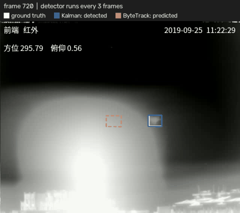
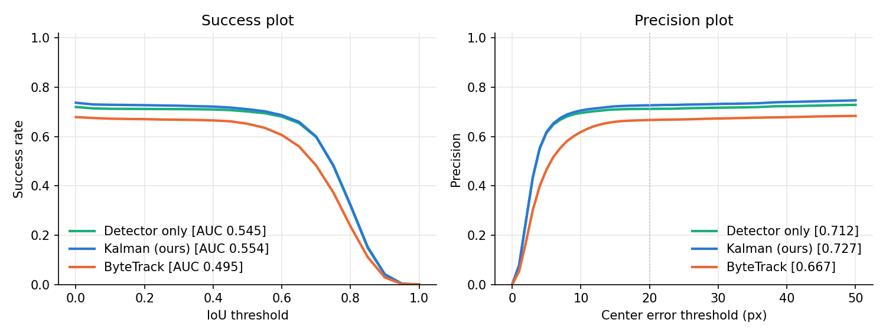
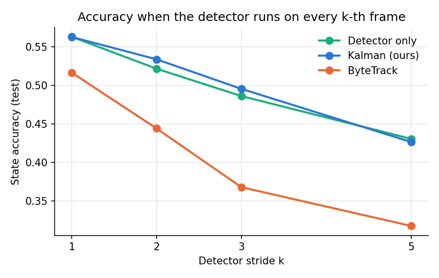

# Anti-UAV Drone Tracking: Kalman Filter vs ByteTrack

Single-drone tracking in infrared video from the Anti-UAV dataset, on top of a YOLOv8 detector. I compare my own Kalman Filter tracker and ByteTrack against a baseline with no tracking. All three methods use the same cached detections. Parameters are tuned only on validation recordings, and the final numbers come from the test recordings using the official Anti-UAV metric.

<p align="center">
  
  <br><em>Detector runs on every 3rd frame. White: ground truth, blue: Kalman, orange: ByteTrack. Dashed boxes are predictions without a detection. I picked this clip because it shows the difference clearly.</em>
</p>

## Main results

1. **A tracker cannot do better than the detector's recall.** On the test recordings the detector finds the drone in only 71% of the frames where it is visible, even at score ≥ 0.05 (98.5% on val). This limits every method. When the detector fails for a long time, no tracker can fix it (for example `1_6`: state accuracy 0.14-0.15 for all methods).
2. **When the detector runs on every frame, Kalman is equal to the baseline** (state accuracy 0.563 for both) and localizes a bit better (Precision@20px 0.727 vs 0.712). It costs 0.04 ms per frame. ByteTrack gets 0.516.
3. **When the detector skips frames, Kalman works best up to k = 3.** At k = 2 and 3 it beats simply repeating the last box. The gap is bigger on val, where the detector is reliable: 0.714 vs 0.675 at k = 3 (these are tuning-set numbers, so they are optimistic). ByteTrack drops from 0.516 to 0.368 at k = 3.
4. **Why ByteTrack drops: IoU matching does not work well for small, fast targets.** The drone box is about 41 px. With k = 3, the drone moves 12 px (median) and 47 px (90th percentile) between two detector runs. So the predicted box and the new detection often do not overlap at all, and ByteTrack starts a new track instead of continuing the old one (100+ track IDs per sequence for a single drone). My Kalman tracker matches by center distance scaled by its own uncertainty (Mahalanobis gating), so it does not need any overlap.
5. **BYTE's second matching round for low-score boxes has almost no effect here** (0.516 → 0.515 without it). The best thresholds are at the bottom of the search range, so nearly every detection already counts as high score.

## Pipeline

```
infrared video ─► YOLOv8m detector ─► cached boxes (score ≥ 0.05) ─┬─► Detector only (no tracking)
                  (run once per video)                              ├─► Kalman tracker
                                                                    └─► ByteTrack (single target)
                                                                             │
                     val recordings: grid search of tracker parameters ◄─────┤
                     test recordings: final metrics with the tuned values ◄──┘
```

- **Data:** [Anti-UAV](https://anti-uav.github.io/) (2020), infrared stream, 640×512 at 20 fps. One drone per sequence, with a per-frame `exist` flag (the drone can leave the view or be hidden).
- **Detector:** YOLOv8m trained with my [Anti-UAV-Drone-Detection](https://github.com/yavuzkrm/Anti-UAV-Drone-Detection) repo (`python train.py infrared`, 15 epochs, val mAP50 0.989). Two whole recordings were left out of detector training. They are the val split here (13 sequences).
- **Test:** the 15 test sequences of the dataset (14,348 frames), recorded separately. Never used for training or tuning.
- **Same input for all methods:** the detector runs once per video and the boxes are cached, so any difference between methods comes only from tracking.

## Methods

| Method | Motion model | Association | When there is no detection |
|---|---|---|---|
| Detector only | none | highest-scoring box | reports nothing (or repeats the last box if the detector was skipped) |
| Kalman, [`tracking/kalman_tracker.py`](tracking/kalman_tracker.py) | 6D constant acceleration on the box center | nearest detection inside a Mahalanobis gate | predicts for up to `max_missed` frames, then drops the track |
| ByteTrack ([ultralytics](https://github.com/ultralytics/ultralytics) version), [`tracking/bytetrack.py`](tracking/bytetrack.py) | 8D constant velocity on center, aspect ratio, height | Hungarian on IoU, two rounds (high score, then low score) | keeps lost tracks for re-matching. Reports the lost target's prediction for `coast` frames (I added this to make the comparison fair) |

ByteTrack is a multi-object tracker. Here it reports one box per frame: the current target while it is tracked, otherwise the highest-scoring track.

## Metrics

| Metric | Definition |
|---|---|
| State accuracy (official Anti-UAV) | Per frame: IoU with ground truth if the drone is visible. If the drone is absent: 1 if no box is reported, 0 otherwise. Averaged over frames, then over sequences |
| Success AUC | Area under the success plot (fraction of visible frames with IoU > t, for t in [0, 1]) |
| Precision@20px | Fraction of visible frames with center error ≤ 20 px |
| False alarm rate | Fraction of absent frames where a box was still reported (only 4 test sequences have absent frames) |

## Results (test split)

| Method | State acc. ↑ | Success AUC ↑ | Precision@20px ↑ | False alarm ↓ | Tracker ms/frame |
|---|---:|---:|---:|---:|---:|
| Detector only | **0.563** | 0.545 | 0.712 | 0.345 | 0.005 |
| Kalman | **0.563** | **0.554** | **0.727** | 0.501 | 0.044 |
| ByteTrack | 0.516 | 0.495 | 0.667 | **0.284** | 0.162 |

The detector takes 13.3 ms per frame (RTX 4060 Laptop GPU), so the tracking cost is very small in comparison.



Kalman has a higher false alarm rate because of coasting: when the drone disappears, it keeps predicting for a few more frames. Turning coasting off removes these false alarms but makes localization worse (see below).

### Ablations

Tuned parameters with one part turned off.

| Variant | State acc. | Success AUC | Precision@20px | False alarm |
|---|---:|---:|---:|---:|
| Kalman | 0.563 | 0.554 | 0.727 | 0.501 |
| - constant velocity instead of acceleration | 0.563 | 0.555 | 0.728 | 0.501 |
| - no coasting (`max_missed = 0`) | 0.563 | 0.545 | 0.714 | 0.345 |
| ByteTrack | 0.516 | 0.495 | 0.667 | 0.284 |
| - BYTE off (no low-score second round) | 0.515 | 0.493 | 0.665 | 0.284 |
| - no coasting (`coast = 0`, default behavior) | 0.508 | 0.485 | 0.653 | 0.133 |

Constant acceleration and constant velocity give the same result at 20 fps. The motion between frames is too small for the acceleration term to matter.

### Frames where the detector misses

1,494 visible test frames have no detection above the baseline's threshold. On these frames a tracker can only help by predicting through the gap:

| Method | Precision@20px | IoU > 0.5 |
|---|---:|---:|
| Detector only | 0.000 | 0.000 |
| Kalman | 0.114 | 0.078 |
| ByteTrack | 0.067 | 0.055 |

Most of these gaps are long (the detector misses many frames in a row), so a short motion prediction can only recover a small part of them.

### Running the detector on every k-th frame

In an embedded anti-UAV system the detector is the expensive part. If YOLO runs only on every k-th frame, the tracker has to fill in the frames between. I re-tuned the parameters on val for each k.

| k | Detector ms/frame | Detector only (repeat last box) | Kalman | ByteTrack |
|---:|---:|---:|---:|---:|
| 1 | 13.3 | 0.563 | 0.563 | 0.516 |
| 2 | 6.7 | 0.521 | **0.534** | 0.444 |
| 3 | 4.4 | 0.486 | **0.495** | 0.368 |
| 5 | 2.7 | **0.431** | 0.427 | 0.318 |



Why ByteTrack falls behind (test split, tuned parameters):

| k | Drone motion between detector runs, median (px) | 90th percentile (px) | ByteTrack track IDs per sequence |
|---:|---:|---:|---:|
| 1 | 4.1 | 19.0 | 118 |
| 3 | 12.0 | 47.0 | 166 |
| 5 | 19.2 | 65.1 | 108 |

The target is about 41 px, so a 47 px jump means the predicted box and the detected box do not overlap, and the IoU cost cannot connect them. The track count is high even at k = 1 because the tuned thresholds are low (0.1), so background clutter can start short tracks.

Per-sequence numbers: [`results/test/per_sequence.csv`](results/test/per_sequence.csv). Full report: [`results/test/summary.md`](results/test/summary.md). Tuned parameters: [`configs/trackers.yaml`](configs/trackers.yaml). All grid-search runs: [`results/val/`](results/val).

## Limitations

- The detector does not generalize well to the test recordings (71% recall limit), and this affects every number above. A better detector (more epochs, more varied training recordings, fusion with the visible stream) would help more than a better tracker.
- Only one sensor (infrared) and one target. ByteTrack's strengths with multiple objects (keeping identities when objects cross) are not tested here.
- The best score thresholds are at the cache limit (0.05), so caching with a lower threshold might change the results a little.
- Timings are from one laptop GPU (RTX 4060 Laptop) and include Python overhead.

## How to reproduce

```bash
pip install -r requirements.txt

# 1. Detector weights: download best_infrared.pt from the v1.0 release
#    https://github.com/yavuzkrm/Anti-UAV-Drone-Tracking/releases/download/v1.0/best_infrared.pt
#    (or train it in the detection repo: python train.py infrared 15),
#    then set `model:` and `data_root:` in configs/config.yaml

python scripts/detect.py          # run YOLO once, cache boxes for val + test
python scripts/tune.py            # grid search on val -> configs/trackers.yaml
python scripts/evaluate.py        # test metrics, tables, plots -> results/
python scripts/visualize.py 20190925_111757_1_7 --stride 3 --start 720 --frames 120 --gif demo.gif

python -m pytest tests            # unit tests, no data needed
```

## Repository structure

```
tracking/
├── dataset.py          # Anti-UAV reader (video + per-frame exist/box), val/test split
├── detections.py       # cached detections, ultralytics-compatible box container
├── kalman.py           # 6D constant-acceleration Kalman Filter
├── kalman_tracker.py   # single-target tracker: gating, coasting, re-acquisition
├── bytetrack.py        # ultralytics BYTETracker reduced to one target, + coasting
├── baseline.py         # detector-only baseline
├── metrics.py          # state accuracy, success AUC, precision, false alarms
└── runner.py           # config, cache paths, run a tracker over a sequence
scripts/                # detect.py, tune.py, evaluate.py, visualize.py
configs/                # config.yaml (paths), trackers.yaml (tuned parameters)
results/                # tables, plots, demo GIFs
tests/                  # unit tests
.github/workflows/      # CI: runs the unit tests on every push and PR
```

## References

- Zhang et al., *ByteTrack: Multi-Object Tracking by Associating Every Detection Box*, ECCV 2022. [arXiv:2110.06864](https://arxiv.org/abs/2110.06864)
- Bewley et al., *Simple Online and Realtime Tracking (SORT)*, ICIP 2016. [arXiv:1602.00763](https://arxiv.org/abs/1602.00763)
- Jiang et al., *Anti-UAV: A Large-Scale Benchmark for Vision-based UAV Tracking*, IEEE TMM 2021. [arXiv:2101.08466](https://arxiv.org/abs/2101.08466)
- Welch & Bishop, *An Introduction to the Kalman Filter*, UNC TR 95-041.
- Ultralytics YOLOv8 and trackers: https://github.com/ultralytics/ultralytics

## Author

Yavuz Kerem Ataç, Computer Engineering, Ankara University

## License

[MIT](LICENSE)
